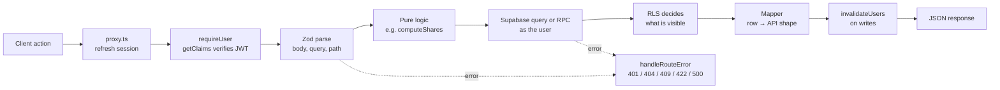

# Architecture

## Overview

```mermaid
flowchart TB
  B[Browser] --> P[src/proxy.ts<br/>session refresh + sign-in gate]
  P --> RSC[Server Components<br/>src/app/(app)/*]
  P --> API[Route handlers<br/>src/app/api/private/*]
  RSC --> UI[Client components<br/>src/components/*]
  UI -->|fetch JSON| API

  API --> Z[Zod validation]
  API --> LIB[Pure modules<br/>src/lib/* — split, forecast, tax,<br/>health score, goals, recurrence]
  API --> C[(Upstash Redis<br/>optional cache)]
  API -->|user's JWT| SB[(Supabase Postgres<br/>RLS + SQL functions)]
  API --> G[Gemini API<br/>copilot]
  AUTH[Supabase Auth<br/>Google OAuth] --> SB
  B -->|OAuth redirect| AUTH
```

Next.js is the only server. There is no separate backend and no service-role key at runtime: every query runs as the signed-in user.

## Request lifecycle



## Authorization, three layers

1. **`src/proxy.ts`** refreshes the session on every request and sends signed-out visitors to `/login` (pages) or answers `401` (API). A convenience, never relied on for ownership.
2. **`requireUser()`** in every route handler verifies the JWT with `supabase.auth.getClaims()` rather than trusting the cookie.
3. **Row-level security** in Postgres is the boundary. Personal tables are owner-only; group tables are members-only. Another user's id therefore returns `404`, the same as an id that does not exist. See [`database.md`](database.md).

## Modules

| Path | Responsibility |
|---|---|
| `src/proxy.ts` | Session refresh and sign-in gate (Next.js 16 proxy, formerly middleware) |
| `src/lib/api-auth.ts` | `requireUser()` — identity for route handlers |
| `src/lib/route.ts` | `handleRouteError`, `must`, `selectAll` (pages past PostgREST's 1,000-row cap), UUID checks |
| `src/lib/supabase/` | Server and browser clients from `@supabase/ssr` |
| `src/lib/data/` | Row-to-API mappers and shared group queries |
| `src/lib/cache.ts` | Redis read-through cache with per-user version invalidation |
| `src/lib/split.ts` | Split strategies: equal, custom, percentage, itemized (paise, largest remainder) |
| `src/lib/money.ts` | `roundCurrency` and amount assertions |
| `src/lib/csv-import.ts` | Statement CSV parsing, column guessing, row normalisation (pure) |
| `src/lib/upi.ts` | UPI deep links and UPI ID validation |
| `src/lib/budget-pace.ts` | Spend against time elapsed in a budget's period |
| `src/lib/rate-limit.ts` | Per-user fixed-window limits for routes that call Gemini |
| `src/lib/recurrence.ts` | Stepping recurring rules; shared by the runner and the forecast |
| `src/lib/forecast.ts` | 90-day cash-flow projection |
| `src/lib/health-score.ts`, `goals.ts`, `tax.ts`, `recurring-detect.ts` | Planning engines, pure and browser-safe |
| `src/lib/copilot/` | Gemini tool-calling loop and read-only tools |
| `src/lib/receipt/` | Receipt extractor interface and registry |
| `src/components/` | UI, grouped by page; `ui/` holds Radix-based primitives |
| `supabase/migrations/` | Schema, RLS policies and SQL functions |
| `src/scripts/` | `verify-calculations`, `verify-db`, `seed-demo` |

## Caching

Read-heavy routes (dashboard, analytics, insights, health, report, tax, group analytics) go through `cached()`. Each user has a version counter in Redis; every write increments the version of every affected user (all members, for group writes), which makes their older entries unreachable. A read that started before a write stores its result under the old version, so it can never repopulate the cache with pre-write data. Entries expire after five minutes. Without Upstash credentials, or if Redis errors, routes compute directly from Postgres.

## Copilot

`POST /api/private/copilot` sends the conversation to Gemini with a set of tool declarations. When the model asks for a tool, the route runs it through the caller's own Supabase client — so RLS scopes it — and feeds the result back, up to six steps. Every tool only reads, with one exception in kind: `draft_transaction` returns a proposed entry that the chat shows as a card. Nothing is saved until the user presses Add, which posts to the ordinary transactions route and is validated like any hand-typed entry. Questions are rate limited per user.

## Receipt scanning

`POST /api/private/receipts/extract` passes an image to whichever extractor `RECEIPT_EXTRACTOR` selects from `src/lib/receipt/registry.ts`, validates the output with Zod, and returns draft line items. The image is never stored and the route never writes to the ledger; the user confirms the items and posts them as an ordinary itemized expense.

## Verification

| Command | Checks |
|---|---|
| `npm run verify:calc` | Split allocation, forecast, recurrence, tax, health score, goals, recurring detection, route error mapping |
| `npm run verify:db` | Applies the migrations to PGlite and checks RLS, every SQL function and the group invariants |
| CI (`.github/workflows/ci.yml`) | Lint, typecheck, both verify scripts, and a production build with no secrets |
