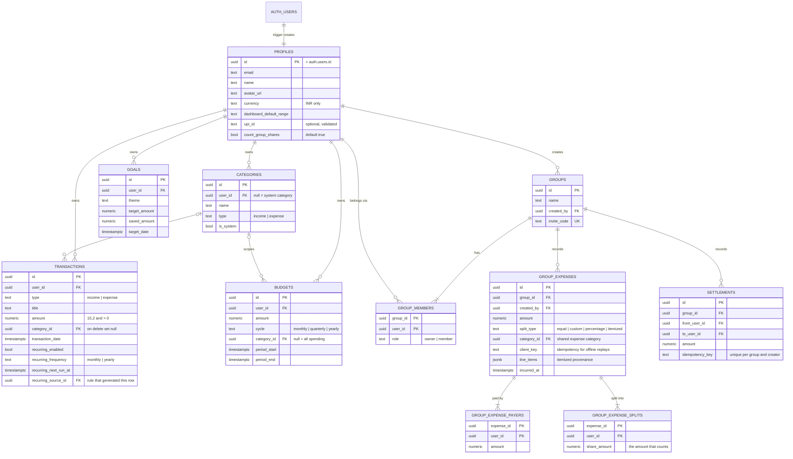

# Database

Fee-Nance runs on Supabase Postgres. The schema of record is `supabase/migrations/`, applied in filename order. This page describes what those files create; if the two disagree, the migrations are right.

`npm run verify:db` applies every migration to an embedded Postgres (PGlite) and checks the row-level security policies, each SQL function and the group invariants. It needs no Supabase project.

## Entity-relationship diagram

## Tables

| Table | Holds | Key constraints |
|---|---|---|
| `profiles` | One row per auth user: name, email, avatar, preferences | PK is `auth.users.id`; created by the `on_auth_user_created` trigger. Users may update only `name`, `currency`, `dashboard_default_range`, `upi_id` and `count_group_shares` (column grants). `upi_id` must look like `name@bank` |
| `categories` | Seven shared system categories plus each user's own | Unique `(user_id, name, type)` with `NULLS NOT DISTINCT`; `is_system = (user_id is null)` |
| `transactions` | Personal income and expenses; a row with `recurring_enabled` is also a recurring rule | `amount > 0`; deleting a category leaves its transactions uncategorised. Unique `(recurring_source_id, transaction_date)`: a rule produces each occurrence once, however many times the runner fires |
| `budgets` | A spending limit over a period, optionally for one category | `period_end > period_start` |
| `goals` | Savings targets and progress | `target_amount > 0`, `saved_amount >= 0` |
| `groups`, `group_members` | Shared ledgers and their members | PK `(group_id, user_id)`; one owner per group |
| `group_expenses` | A shared bill | Cascades from `groups`; `category_id` must be a shared expense category (checked by the write functions); `line_items` records how an itemized split was derived |
| `group_expense_payers`, `group_expense_splits` | Who paid and who owes what, per expense | PK `(expense_id, user_id)`; sums checked by `create_group_expense` |
| `settlements` | Repayments between two members | `from_user_id <> to_user_id`; unique `(group_id, created_by, idempotency_key)`; only the payer or payee can insert |

Money is `numeric(15,2)`, so storage is exact and the write functions compare sums with `=`, not a tolerance. Application arithmetic still uses JavaScript numbers rounded with `roundCurrency`, except equal, percentage and itemized allocation, which work in integer paise.

## Row-level security

Every table has RLS enabled. API routes query Supabase with the signed-in user's JWT, so the policies below decide what any request can read or write.

| Table | Read | Write |
|---|---|---|
| `profiles` | Yourself, and anyone you share a group with | Yourself, limited columns |
| `categories` | System categories and your own | Your own, never system ones |
| `transactions`, `budgets`, `goals` | Owner only | Owner only. A transaction or budget can only use a system category or the owner's own, and a transaction can only point at the owner's own recurring rule |
| `groups`, `group_members`, `group_expenses`, payers, splits | Members of the group | Only through the SQL functions below |
| `settlements` | Members of the group | Insert: the payer or payee, between two members. Delete: the payer, the payee or whoever recorded it |

Membership is checked by `is_group_member()` and `shares_group_with()`, both `SECURITY DEFINER`, so a policy on `group_members` can ask about membership without recursing into its own policy.

## The personal ledger

`my_ledger_entries(start, end, include_group_shares)` is the one place that defines "my money": the caller's transactions, plus their *share* of every group expense as an expense in that expense's category on the day it was incurred. What the caller *paid* for a group is deliberately absent. Paying ₹3,000 for a ₹1,000 share is ₹1,000 of spending and ₹2,000 owed back, not ₹3,000 of spending. Pass `false` for personal transactions only; `null` (the default) follows the caller's `count_group_shares` preference.

The `ledger_*` totals and `budget_spend` all read from it, so the dashboard, analytics, report, forecast, budgets and copilot agree. It is `SECURITY DEFINER` (every branch filters on `auth.uid()`) so a former group member keeps their share in their own history. The `insights_*` detectors read personal transactions only: an outlier or a duplicate is something you entered.

## Functions

Read functions are `SECURITY INVOKER`: they run as the caller, RLS still applies, and they filter on `auth.uid()` explicitly so the planner can use the `(user_id, …)` indexes.

| Function | Purpose |
|---|---|
| `my_ledger_entries` | The caller's transactions plus their group shares (above) |
| `ledger_type_totals`, `ledger_balance_before` | Income and expense totals, and balance as of a date |
| `ledger_category_totals`, `ledger_monthly_totals`, `ledger_quarterly_totals`, `ledger_daily_net` | Breakdowns for the dashboard, analytics and report |
| `budget_spend(ids)` | Spend inside each budget's own period and category, in one query, group shares included |
| `group_member_net(group, user)` | A member's net position in a group (paid − owed ± settlements) |
| `insights_outliers` | Each expense against the eleven before it in its category (z-score) |
| `insights_duplicates` | Same amount and title within 48 hours |
| `insights_drift` | Each category-month against its trailing three-month average |

Group writes are `SECURITY DEFINER` because they touch several tables atomically. Each checks the caller's membership itself first.

| Function | Purpose |
|---|---|
| `create_group(name)` | Creates the group and the owner's membership |
| `join_group(code)` | Joins by invite code; idempotent |
| `leave_group(id)` | Leave, refused while the caller's net position is not zero. An owner hands the group to the longest-standing member; the last member out deletes it |
| `delete_group(id)` | The owner deletes the group, and its history, for everyone |
| `is_demo` (transactions, budgets, goals) | Marks made-up sample rows from the first-run tour so "Remove sample data" deletes exactly those. Partial indexes keep it cheap |
| `create_group_expense(...)` | Writes the expense, payers and splits in one transaction. With `p_client_key`, a repeat by the same author in the same group returns the expense already written (unique index `(group_id, created_by, client_key)`), which is what makes an offline replay safe |
| `update_group_expense(...)` | Replaces an expense's fields, payers and splits in one transaction. The person who added it, or the group owner |
| `delete_group_expense(id)` | Deletes it. Same permission |
| `check_group_expense_parts(...)` | Shared by create and update: members only, no one twice, payers and shares each equal the total exactly, category is a shared expense category |
| `generate_invite_code()` | Eight characters from a 32-letter alphabet (uses `random()`, not a cryptographic source) |

Execute is revoked from `PUBLIC` on every function and granted to `authenticated` only; the trigger helpers are not callable.

## Indexes

| Index | Serves |
|---|---|
| `transactions (user_id, transaction_date desc)` | Ledger lists and every date-bounded total |
| `transactions (user_id, type, transaction_date desc)` | Income/expense totals and insights |
| `transactions (user_id, category_id, transaction_date desc)` | Category breakdowns and budget spend |
| `transactions (user_id, recurring_next_run_at) where recurring_enabled` | Finding due recurring rules |
| `budgets (user_id, period_start desc)` | Budget lists |
| `goals (user_id, created_at desc)` | Goal lists |
| `group_members (user_id)` | "My groups" and membership checks |
| `group_expenses (group_id, incurred_at desc)` | Group ledgers and balances |
| `settlements (group_id, settled_at desc)` | Settlement history and balances |

## Invariants

These hold for every group and are checked at write time by `create_group_expense` and across existing data by `GET /api/private/diagnostics`:

- The splits of an expense sum to its amount, exactly.
- The payments of an expense sum to its amount, exactly.
- Every payer and every participant is a member of the group when the expense is written, and appears once.
- A member can only leave with a net position of zero, so a departed member never carries a balance.
- Net balances across a group's members sum to zero.
